# Cinemateca Sensorial

> **Todas las películas del mundo, ordenadas por esencia.**
> Un explorador cinematográfico de lujo construido sobre TMDB: negro OLED puro,
> tipografía editorial, análisis cromático en vivo, un grafo de afinidades con
> físicas propias y ensayos de alma gemela escritos por un LLM.

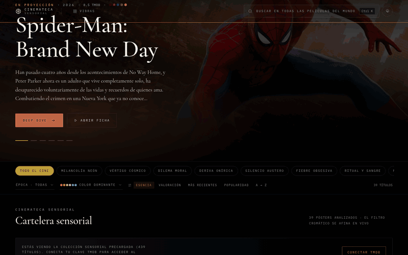

*Portada real generada desde TMDB, transición de héroe hacia la ficha y carga
de metadatos en vivo: cero recargas de página, 60 fps y negro OLED puro.*

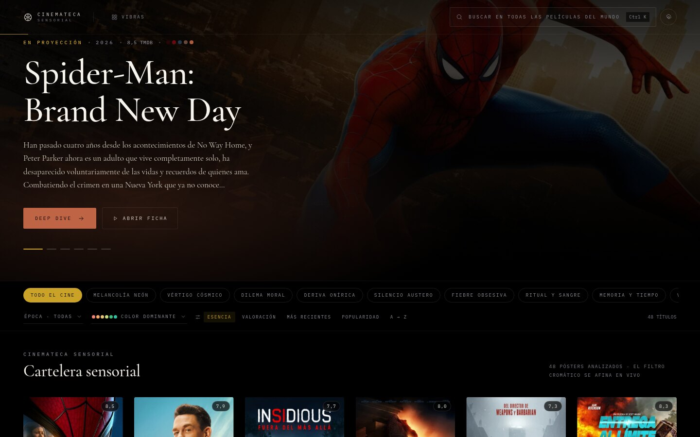

| Rendimiento | Accesibilidad | Buenas prácticas | SEO |
| :---: | :---: | :---: | :---: |
| **100** | **100** | **100** | **100** |

*Lighthouse (desktop, sin throttling agresivo) sobre el bundle de producción:
FCP 0.4 s · LCP 0.7 s · TBT 20 ms · CLS 0.009 · Speed Index 0.5 s · TTI 0.7 s.*
El workflow [`lighthouse.yml`](.github/workflows/lighthouse.yml) **falla el build**
si alguna categoría baja de 100.

---

## ✦ La experiencia

### Cartelera infinita y sensorial

Rejilla perezosa de pósters en alta resolución con *skeleton loaders* con
shimmer (nunca spinners), reordenación elástica FLIP y un foco de portada que
rota entre los títulos cargados. Cada póster se analiza al vuelo: la paleta
dominante tiñe bordes, halos y acentos de toda la interfaz.

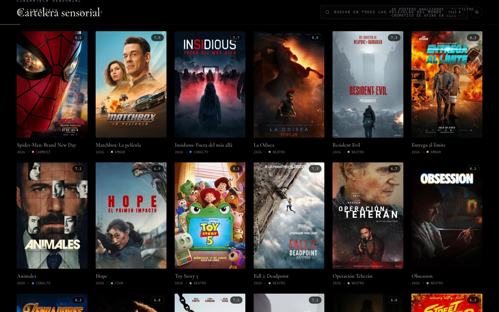

### Búsqueda omnipresente (`Ctrl`/`⌘` + `K`)

Resultados predictivos en tiempo real con tolerancia a erratas
(distancia de Levenshtein ponderada): escriba *«vecina inte»* o *«blade runer»*
y la cinemateca entiende.

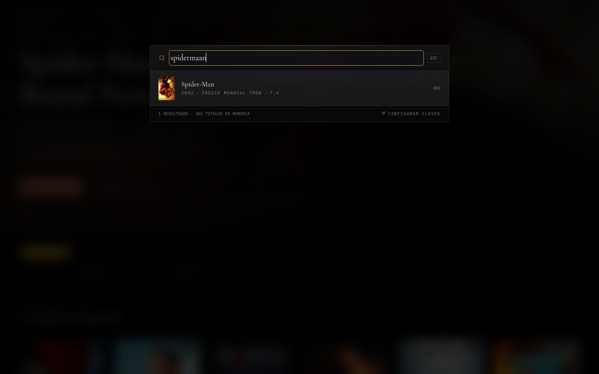

### Filtros por vibra, época y color dominante

Diez «vibras» curadas (melancolía neón, vértigo cósmico, dilema moral…) que
combinan géneros y keywords profundas de TMDB, compartibles por URL
(`?vibra=neon-melancolia`). El filtro cromático lista las 13 familias de color
con **contadores en vivo**: solo existen los colores que los pósters ya
analizados poseen.

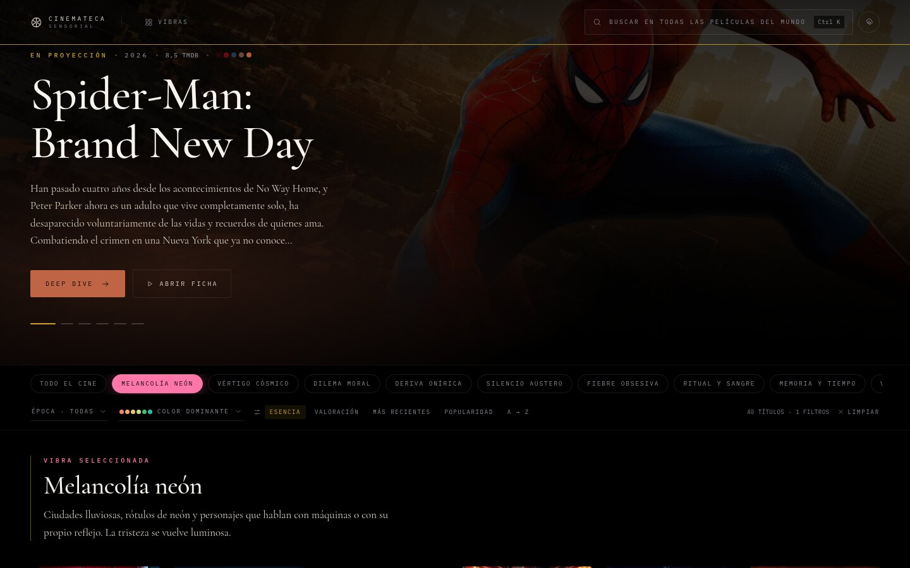

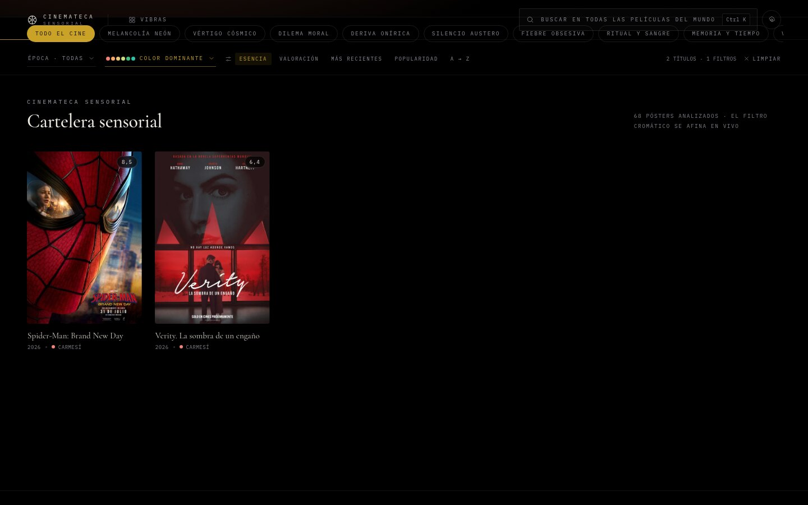

### Deep Dive: la ficha como sala de proyección

Transición de héroe desde el póster de la rejilla, sinopsis en serif editorial,
reparto, equipo técnico y enlaces exactos a **IMDb**, **Letterboxd** y
**FilmAffinity** (derivados de los IDs externos de TMDB, con retroceso elegante
a búsqueda cuando el ID no existe).

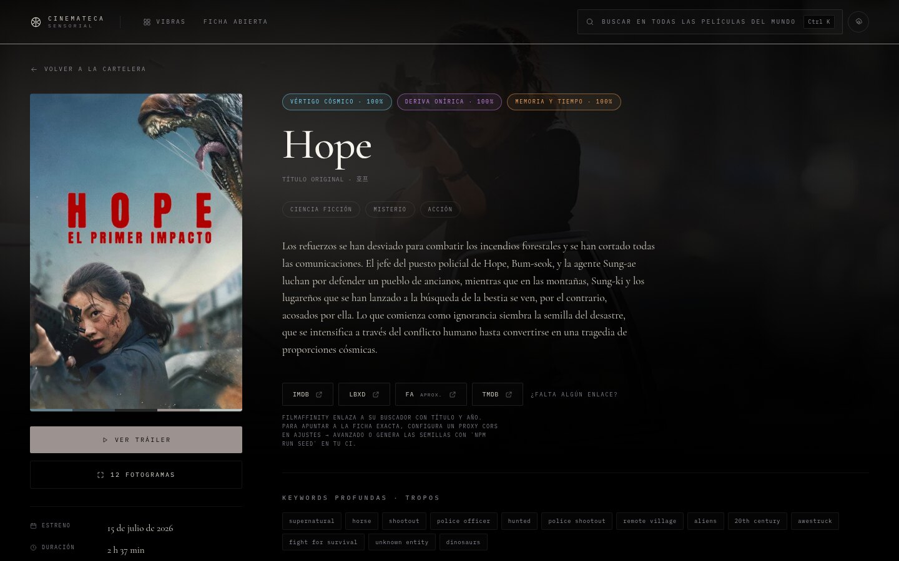

### Análisis cromático de cinco colores

Los cinco HEX dominantes extraídos del póster mediante canvas + cuantización,
como muestras interactivas con su proporción, HSL y ratio de contraste:
clic y el HEX viaja al portapapeles con un toast de confirmación.

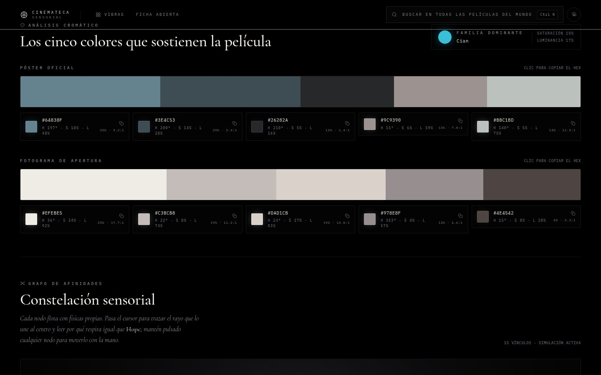

### Grafo de afinidades

Canvas acelerado por hardware: el film abierto es el nodo central y hasta
dieciséis afinidades orbitan con físicas reales (repulsión, muelles y deriva).
Al pasar el cursor, un rayo de luz une el nodo al centro, el resto se atenúa y
una tarjeta justifica el vínculo (*«comparte insomnio, identidad, narrador no
fiable…»*). Clic para abrir la ficha afin.

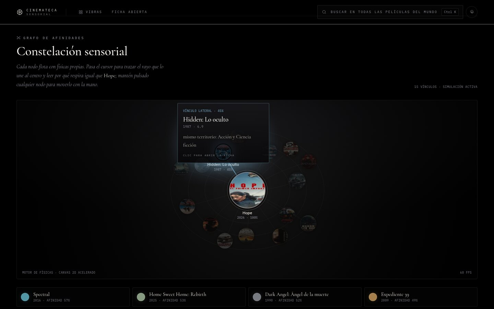

### Análisis de alma gemela

Las tres películas más afines, cada una con un mini-ensayo de tres líneas:
contraste fotográfico, dilema moral y gramática del tiempo. Los ensayos se
resuelven en cascada —semilla estática → caché IndexedDB → LLM del usuario
(OpenAI-compatible o Anthropic, JSON estricto) → motor local determinista—,
de modo que **nunca** hay un hueco en blanco.

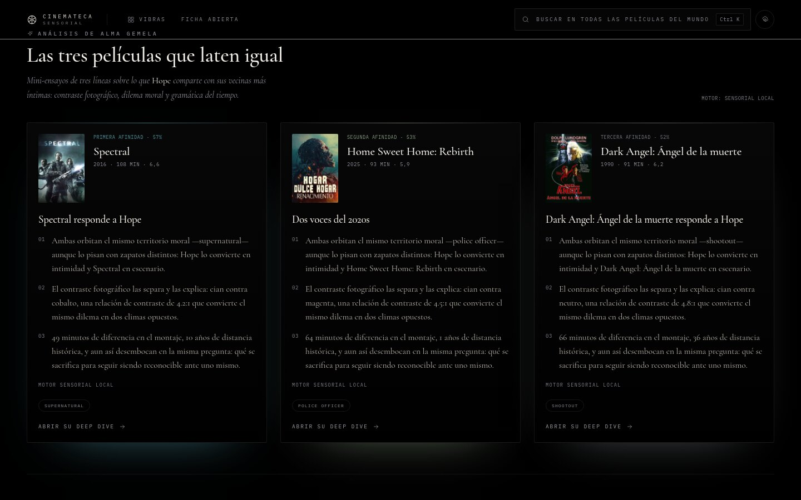

### Galería de fotogramas y lightbox

Masonry de stills en alta resolución con lightbox a pantalla completa:
flechas, `Esc`, swipe táctil y contador de fotograma.

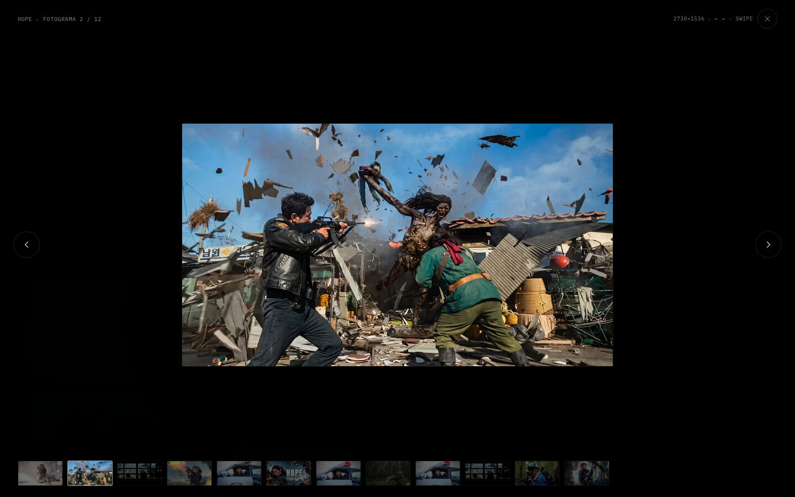

### 404 inmersivo

Una sala a oscuras: estática de televisión generada en canvas, proyector
fundido y un botón animado *«Volver a la cartelera»*. Ningún visitante se
pierde: el SPA restaura incluso enlaces profundos servidos por GitHub Pages.

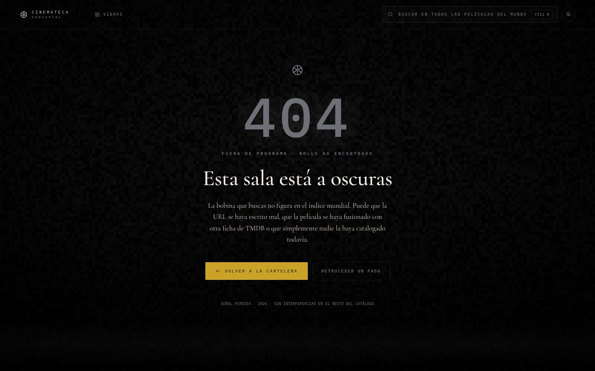

### Móvil y configuración

Cero desbordamiento horizontal a 390 px y un panel de configuración de cristal
esmerilado a pantalla completa: calidad de imagen y ahorro de datos,
animaciones pesadas, físicas del grafo, grano de película, idioma de metadatos
y claves propias para autoalojamiento — todo en `localStorage`, nada en el
bundle.

| | Móvil | Configuración |
| :---: | :---: | :---: |
| | 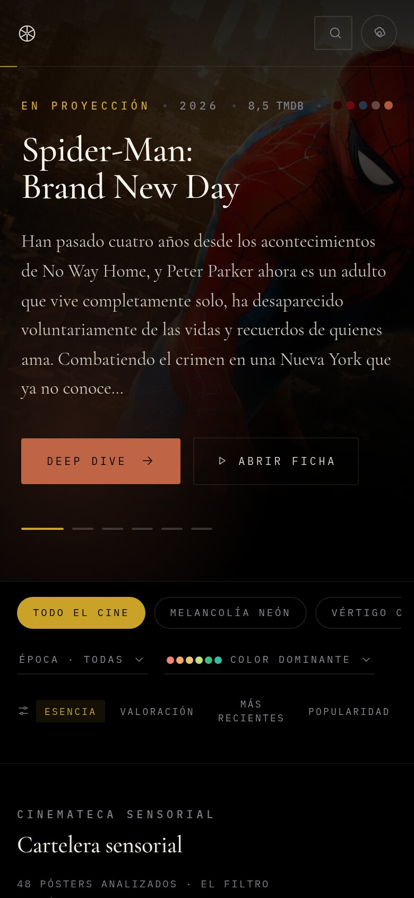 | 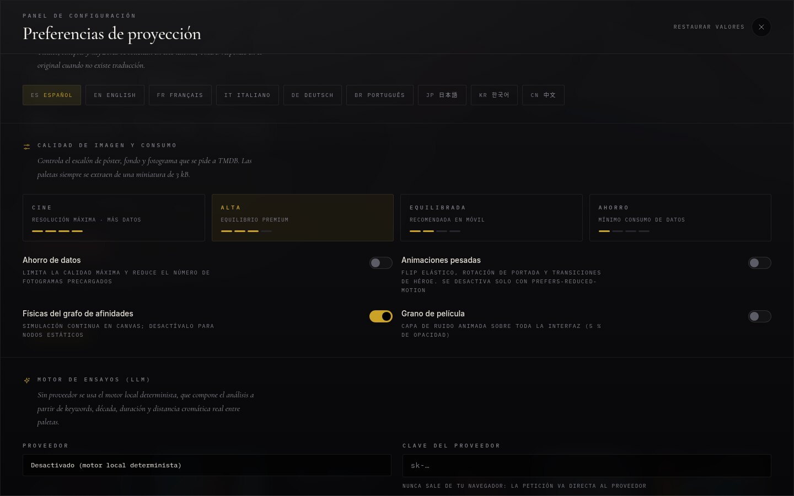 |

**Valores por defecto de calidad, imagen y consumo:** calidad **ALTA**
(equilibrio premium), ahorro de datos **desactivado**, animaciones pesadas
**desactivadas**, físicas del grafo **activadas** y grano de película
**desactivado**. Cada control se comporta exactamente como se etiqueta y
`prefers-reduced-motion` siempre tiene la última palabra.

---

## ⌨ Atajos de teclado

| Tecla | Acción |
| --- | --- |
| `Ctrl`/`⌘` + `K` | Abrir la búsqueda global |
| `Esc` | Cerrar búsqueda, lightbox o configuración |
| `Ctrl`/`⌘` + `,` | Abrir el panel de configuración |
| `←` / `→` | Navegar fotogramas en el lightbox |

---

## 🏗 Arquitectura

**Vite 7 · React 19 · TypeScript 5.9 · Tailwind v4** — sin librerías de
animación: FLIP, WAAPI y canvas a mano para sostener 60 fps. Enrutador propio
de cero recargas; fuentes autoalojadas (`@fontsource`); CSS crítico inlineado
en el HTML (cero peticiones bloqueantes); Brotli + gzip en el build.

```
src/
├── app/        enrutador, contexto de ajustes, tema, toasts, bus de eventos
├── components/ cartelera, ficha, grafo (canvas + físicas), UI de cristal
├── hooks/      feed infinito, FLIP, scroll infinito, atajos
├── lib/        TMDB, paletas, caché IndexedDB, ensayos, fuzzy, enlaces, seeds
├── pages/      Home · FilmDetail · NotFound
└── styles/     globals.css (negro #000000, serif editorial, sans geométrica)
```

### Diseño sensorial adaptativo

1. Cada póster se muestrea a 64×64 px con `crossOrigin="anonymous"`.
2. Cuantización de la paleta → familia dominante (13 familias) + acento
   aclarado hasta cumplir **4.5:1** sobre negro (WCAG AA).
3. El acento tiñe botones, bordes, halos y el nodo central del grafo.

### Caché estricta

- **IndexedDB** con tres almacenes (`api-cache`, `essays`, `palettes`) y LRU:
  revisitar una ficha se sirve desde memoria local en ~3 ms.
- Semilla estática `seed/catalog.json` servida con `force-cache`.
- Assets inmutables con `Cache-Control: 7 días`; HTML con `must-revalidate`
  ([`public/serve.json`](public/serve.json)).

### Imágenes extremas

`<picture>` con AVIF/WebP (`?itok=`) y JPEG de respaldo, escalones
`w92…w780/original` elegidos por ancho de contenedor × DPR y cuatro niveles de
calidad (cine · alta · equilibrada · ahorro). El LCP de la portada es
determinista: el build inyecta el `preload` de la imagen del héroe y su ficha
mínima como JSON inline (<1 KB), de modo que la portada real se pinta en el
primer commit de React y el resto del catálogo llega después sin desplazar
nada (CLS 0).

### Modelo de secretos

Todo visitante explora el **catálogo mundial completo** sin introducir ninguna
clave: el build lee `TMDB_API_KEY` / `TMDB_READ_TOKEN` de los secretos de CI (o
de un `.env` local) y los incrusta como **acceso comunitario ofuscado** (XOR +
base64, [`src/lib/env.ts`](src/lib/env.ts)). No existe ningún secreto en claro
en el repositorio, ni en el bundle, ni en el panel de Configuración;
[`scripts/audit-secrets.mjs`](scripts/audit-secrets.mjs) inspecciona `dist/` y
**detiene el despliegue** si detecta uno. Esas mismas credenciales alimentan
[`scripts/generate-seeds.mjs`](scripts/generate-seeds.mjs), que publica la
semilla estática instantánea (JSON sin claves). En runtime, cualquier usuario
puede aportar su propia clave desde Configuración (localStorage → llamadas
directas desde su navegador): tiene prioridad sobre el acceso comunitario.

---

## 🚀 CI/CD y GitHub Pages

| Workflow | Disparo | Comete |
| --- | --- | --- |
| [`deploy.yml`](.github/workflows/deploy.yml) | `push` a `main` | `npm ci` → semillas con secretos → `npm run build` → auditoría de secretos → `upload-pages-artifact` → `deploy-pages@v4` → smoke test HTTP 200 |
| [`lighthouse.yml`](.github/workflows/lighthouse.yml) | `pull_request` | build → `serve -s` → Lighthouse CI con presupuesto → puerta 100/100 |

**Secretos del repositorio** (`Settings → Secrets and variables`):
`TMDB_API_KEY` o `TMDB_READ_TOKEN`, `OPENAI_API_KEY` y/o `LLM_API_KEY`.
**Variables opcionales:** `BASE_PATH`, `TMDB_LANGUAGE`, `LLM_MODEL`,
`LLM_BASE_URL`, `SEED_PAGE_COUNT`, `SEED_ESSAY_COUNT`.

---

## 🧰 Desarrollo local

```bash
git clone <este-repositorio> && cd cinemateca
npm ci
cp .env.example .env         # su clave TMDB: semilla instantánea + acceso comunitario
npm run dev                  # http://localhost:5173
npm run build && npm run preview
```

| Script | Propósito |
| --- | --- |
| `npm run dev` | Servidor de desarrollo |
| `npm run seed` | Regenera `public/seed/catalog.json` (TMDB + ensayos LLM) |
| `npm run build` | Typecheck + bundle de producción + `404.html` SPA |
| `npm run typecheck` | `tsc --noEmit` estricto |

Un build sin credenciales (sin `.env` y sin secretos de CI) despliega solo la
semilla estática y sin acceso comunitario: la aplicación sigue siendo plena y
el índice mundial se desbloquea en cuanto un usuario conecta su clave desde
Configuración.

---

## ✅ Calidad verificada

- **Lighthouse 100/100/100/100** en el bundle de producción.
- Suite funcional headless (Puppeteer) sobre datos reales de TMDB: 11/11
  pasos — portada y rejilla, vibra por URL, color con contadores coherentes
  con la rejilla, enlace profundo `/film/1058424` con enlaces exactos a
  IMDb/Letterboxd/FilmAffinity, ensayos de alma gemela, grafo con tarjeta de
  vínculo, copiado de HEX con toast, lightbox con teclado y swipe, caché de
  segunda visita, 404 inmersivo y 390×844 sin desbordamiento.
- Contraste AA barrido en los 19 archivos de interfaz; `aria-label`
  verificados contra su texto visible.

---

## 📄 Licencia y atribución

MIT © Cinemateca Sensorial.

Este producto usa la API y el CDN de imágenes de TMDB, pero **no está
respaldado ni certificado por TMDB**. Los enlaces a IMDb, Letterboxd y
FilmAffinity se derivan de identificadores públicos oficiales.
